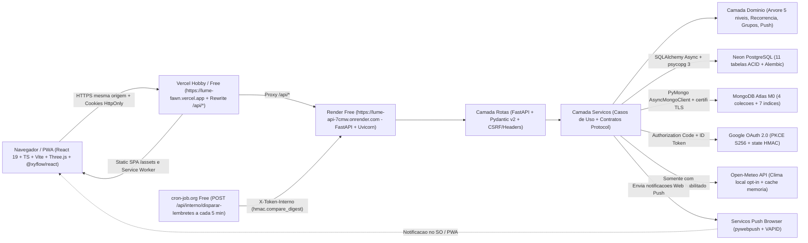
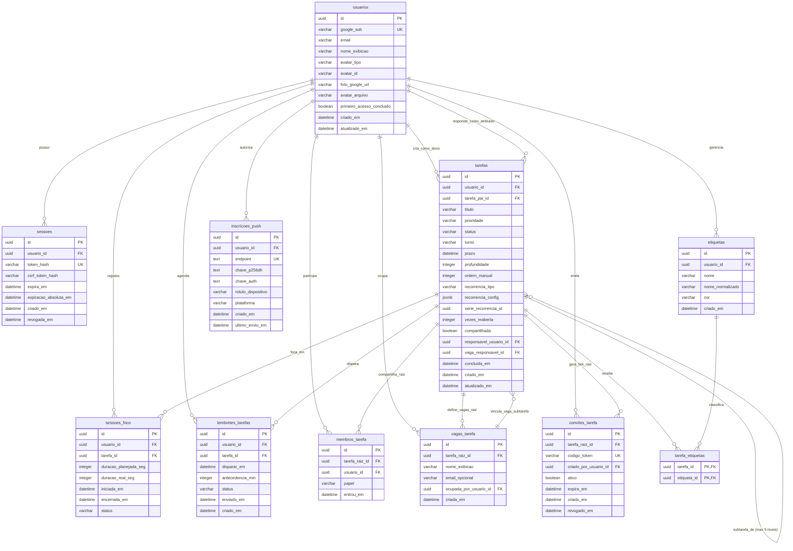

# Arquitetura poliglota, modelagem de dados e contrato de API - Lume (Web II)

Este documento consolida a arquitetura em nuvem e camadas **SOLID**, o diagrama Entidade-Relacionamento (**PostgreSQL**), o esquema documental (**MongoDB**) e o contrato **OpenAPI 3.1.0** exportavel do sistema **Lume**, para avaliacao academica na disciplina **Web II**.

---

## 1. Arquitetura poliglota, nuvem e comunicacao

O sistema opera com persistencia poliglota dividida por natureza de dado, autenticacao **Google OAuth 2.0** no servidor em mesma origem (via proxy `/api/*` na **Vercel**) e agendamento gratuito de lembretes **Web Push (`VAPID`)**.

### Divisao de responsabilidades (SOLID na pratica)
- **`Backend/src/dominio/`:** regras puras sem dependencia de banco ou framework (arvore de ate `5` niveis e bloqueio de ciclos, calculo de progresso por folhas, recorrencia periodica `diaria`/`semanal`/`mensal`, matriz de papeis **Lider** vs **Membro colaborador**, limites equilibrados `D09` e validacoes de push/lembretes).
- **`Backend/src/contratos/`:** portas tipadas via `Protocol` para repositorios relacionais, documentais, Google OAuth, Open-Meteo e Web Push.
- **`Backend/src/servicos/`:** orquestracao dos casos de uso (ACID primeiro no PostgreSQL, persistencia complementar idempotente no MongoDB, disparo best-effort de Web Push em eventos de grupo).
- **`Backend/src/infraestrutura/`:** adaptadores concretos (`postgres`, `mongo`, `google`, `open_meteo`, `webpush`, armazenamento de avatar e desfazer em memoria).
- **`Backend/src/rotas/`:** fronteira HTTP FastAPI, autenticacao via cookie de sessao + `X-CSRF-Token`, validacao Pydantic v2 e envelope de erro padronizado em `pt-BR`.

---

## 2. Diagrama Entidade-Relacionamento completo (PostgreSQL)

Extraido diretamente do metadado `BaseRelacional` e das `4` migracoes versionadas do **Alembic** (`20261121_0001` a `20261122_0004`), contemplando todas as **`11` tabelas**:

---

## 3. Esquema documental e indices (MongoDB)

Definido em [indices.py](../Backend/src/infraestrutura/mongo/indices.py), operando com `4` colecoes e `7` indices idempotentes garantidos na inicializacao da API:

| Colecao | Campos principais | Indices (`nome`) | Finalidade |
| --- | --- | --- | --- |
| `detalhes_tarefas` | `_id`, `tarefa_id`, `usuario_id`, `notas_em_blocos` (6 tipos ricos), `metadados_visuais` (`forma_botanica`, `cor_estrela`, `icone`), `atualizado_em` | `uq_detalhes_tarefa_id` (`tarefa_id` UNIQUE), `ix_detalhes_usuario_id` (`usuario_id`) | Notas ricas em blocos e metadados esteticos por tarefa sem sobrecarregar consultas estruturais SQL. |
| `layouts_constelacao` | `_id`, `usuario_id`, `tarefa_raiz_id`, `nos` (`{ tarefa_id: { x, y, fixado } }`), `viewport` (`zoom`, `centro_x`, `centro_y`), `atualizado_em` | `uq_layout_usuario_raiz` (`usuario_id`, `tarefa_raiz_id` UNIQUE) | Salva posicoes individuais de cada usuario no mapa `@xyflow/react`, inclusive em grupos. |
| `eventos_ciclo` | `_id`, `usuario_id`, `autor_usuario_id`, `tarefa_id`, `tarefa_raiz_id`, `tipo_evento`, `momento_do_dia`, `resumo`, `detalhes`, `criado_em` | `ix_eventos_usuario_criado_em` (`usuario_id`, `criado_em DESC`), `ix_eventos_autor_criado_em` (`autor_usuario_id`, `criado_em DESC`), `ix_eventos_raiz_criado_em` (`tarefa_raiz_id`, `criado_em DESC`) | Alimenta o Diario do Ciclo pessoal e a linha do tempo de colaboracao das equipes. |
| `preferencias_cenario` | `_id`, `usuario_id`, `modo_temporal`, `hora_simulada`, `qualidade_3d`, `reduzir_movimento`, `clima` (`habilitado: false` padrao), `audio` (`habilitado: false` padrao), `tutorial` (`status`, `etapa_atual`), `atualizado_em` | `uq_preferencias_usuario_id` (`usuario_id` UNIQUE) | Preferencias visuais, clima opt-in, audio opt-in e persistencia multi-dispositivo do tour guiado. |

### Estrategia de consistencia poliglota e exclusao `EXCLUIR`
1. Operacoes estruturais sao gravadas primeiro em transacao atomica no PostgreSQL.
2. Em seguida, os documentos complementares (`detalhes_tarefas`, `layouts_constelacao`, `eventos_ciclo`) sao gravados/atualizados de forma idempotente no MongoDB, com *fallback* seguro em leituras caso o banco documental oscile.
3. Na exclusao definitiva de conta (`POST /api/conta/excluir` com `EXCLUIR`), [limpador_conta_mongo.py](../Backend/src/infraestrutura/mongo/limpador_conta_mongo.py) remove registros por `usuario_id` e por `autor_usuario_id` (inclusive eventos gerados em grupos de terceiros) antes da remocao do usuario no PostgreSQL (`ON DELETE CASCADE`).

---

## 4. Seguranca e privacidade implementadas

- **Autenticacao sem senha propria:** Google OAuth 2.0 com PKCE `S256` sem padding e `state` assinado por HMAC com expiracao de `10` minutos.
- **Sessao e CSRF:** cookie `lume_sessao` (`HttpOnly`, `SameSite=Lax`, `Secure=true` em producao) com validade deslizante de `7` dias e teto absoluto de `30` dias no PostgreSQL, combinado a `lume_csrf` + cabecalho obrigatorio `X-CSRF-Token` em mutacoes e acao de sair de todos os dispositivos.
- **Cabecalhos HTTP defensivos:** middleware global em [principal.py](../Backend/src/principal.py) e [vercel.json](../Frontend/vercel.json) aplicando `X-Content-Type-Options: nosniff`, `X-Frame-Options: DENY`, `Referrer-Policy: strict-origin-when-cross-origin`, `Permissions-Policy: camera=(), microphone=(), payment=()` e `Cache-Control: no-store` em rotas sensiveis.
- **Autorizacao multiusuario em grupos:** separacao explicita entre arvores privadas e compartilhadas, restricao estrita entre **Lider** e **Membro colaborador**, cancelamento automatico de lembretes pendentes ao remover membro de grupo ativo e respostas `404` para nao-membros sem vazamento de existencia.
- **Privacidade opt-in:** clima local Open-Meteo (`habilitado: false`), audio Web Audio API e notificacoes Web Push (`VAPID`) exigem autorizacao explicita; disparo interno de cron valida `X-Token-Interno` via `hmac.compare_digest`.

---

## 5. Contrato OpenAPI 3.1.0 exportavel

- **Especificacao JSON completa versionada no repositorio:** [openapi.json](openapi.json) (`OpenAPI 3.1.0`, **`53` rotas** e **`110` esquemas** exportados diretamente do FastAPI via `app.openapi()`).
- **Documentacao interativa em producao (Swagger UI):** `https://lume-api-7cmw.onrender.com/docs`
- **Comando para regenerar localmente:** detalhado na Secao 6 de [Ambiente-local.md](Ambiente-local.md).
