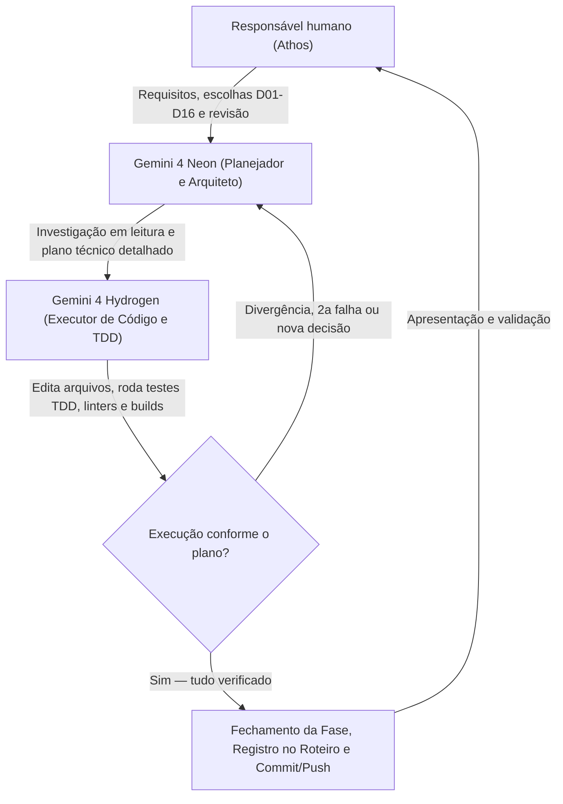

# Processo de desenvolvimento assistido por IA — Horizonte Vivo (nome provisório)

Este documento registra a metodologia de engenharia de software adotada na construção do projeto para a disciplina **Web II**. Ele detalha como o protagonismo humano se combina com a orquestração multimodelo no **Google Antigravity** — utilizando o modo **Orchestrator** com **Gemini 4 Neon** e **Gemini 4 Hydrogen** — sobre uma base disciplinada de **Spec-Driven Development (SDD)**, **SOLID** e **TDD**.

As diretrizes normativas e regras operacionais do projeto estão formalizadas em [Regras.md](../Agents/Regras.md), os requisitos em [Detalhes.md](Detalhes.md), a arquitetura em [Planejamento-tecnico.md](Planejamento-tecnico.md) e o plano de execução em [Roteiro-primeira-entrega.md](Roteiro-primeira-entrega.md).

---

## 1. Propósito: engenharia assistida por IA vs. *vibe coding*

Em vez de pedir código solto para uma IA gerar telas e funções improvisadas (*vibe coding*), este projeto adota **engenharia assistida por agentes com especificações explícitas**:

- **Nenhuma linha de código nasce antes das decisões:** primeiro levantamos requisitos, regras da árvore de tarefas, divisão entre PostgreSQL e MongoDB, contratos e arquitetura.
- **Toda decisão relevante é documentada:** o que ainda está em aberto fica registrado na matriz `D01`–`D16` em [Roteiro-primeira-entrega.md](Roteiro-primeira-entrega.md), proibindo a IA de inventar regras silenciosamente.
- **Todo comportamento executável é testado antes de existir (TDD):** a IA não apenas escreve código, mas comprova o ciclo Vermelho → Verde → Refatoração e executa linters, tipagem estática e inspeções reais.

---

## 2. Protagonismo humano vs. papel dos agentes (*Human-in-the-loop*)

O desenvolvimento divide responsabilidades claras entre o responsável pelo projeto e os agentes de IA:

| Papel | Responsabilidades principais | Limites |
| --- | --- | --- |
| **Responsável humano (Athos — Idealizador / Product Owner / Revisor)** | Conceber a ideia central do produto (simulação viva da passagem do dia, jardim, sol/lua e constelações); escolher a stack (FastAPI, React/TS/Vite, PostgreSQL + MongoDB); responder às decisões `D01`–`D16`; aprovar protótipos, identidade visual e experiência; gerir contas e credenciais externas. | Não precisa escrever código repetitivo manualmente; concentra-se em direção de produto, qualidade, decisões e validação. |
| **Agentes de IA (Google Antigravity)** | Conduzir entrevistas estruturadas (`/grill-me`), redigir especificações SDD, propor alternativas concretas para decisões abertas, implementar backend e frontend em `pt-BR` aplicando SOLID e TDD, rodar testes e documentar resultados e limitações. | Proibidos de resolver decisões abertas sem aprovação, de inventar dados/resultados não observados e de gravar segredos no código. |

---

## 3. Como funciona o modo Orchestrator no Google Antigravity

O projeto é desenvolvido na plataforma **Google Antigravity** utilizando o modo **Orchestrator**, uma arquitetura **multimodelo em duas fases** dentro da mesma conversa. Em vez de usar um único modelo para tudo, o sistema alterna dinamicamente entre um modelo especialista em planejamento/arquitetura e um modelo especialista em execução rápida e verificada.

### 3.1 Fluxo de trabalho entre os modelos

### 3.2 Peculiaridades dos modelos no modo Orchestrator (Neon)

| Aspecto | Gemini 4 Neon (Planejador / Revisor) | Gemini 4 Hydrogen (Executor) |
| --- | --- | --- |
| **Papel principal** | Arquiteto de software, tech lead e revisor técnico. | Engenheiro de execução ágil para implementação e verificação. |
| **Modo de atuação** | Opera em **modo de planejamento** (investigação somente-leitura, leitura da base SDD, análise de impacto e desenho do plano). | Opera em **modo de execução** (criação/edição de arquivos, comandos no terminal, migrações, suítes de testes e Git). |
| **Forças e peculiaridades** | Raciocínio profundo com níveis ajustáveis de pensamento, excelente para decisões arquiteturais, modelagem poliglota, prevenção de ciclos e decomposição segura de tarefas complexas. | Alta velocidade de resposta e menor consumo de cota/latência em ciclos iterativos, ideal para codificação direta, refatorações focadas e loops rápidos de TDD. |
| **O que executa neste projeto** | Conduz o `/grill-me`, define contratos SDD, planeja cada fase, define critérios de verificação e revisa impasses técnicos. | Cria os documentos/código conforme o plano aprovado, roda `pytest`, `vitest`, `mypy`, `ruff`, `tsc`, `eslint`, executa o ciclo TDD e publica commits/push autorizados. |
| **Quando aciona o outro modelo** | Ao finalizar e aprovar o plano estruturado, entrega a execução ao `Hydrogen`. | Devolve o controle ao `Neon` imediatamente se algo assumido no plano faltar, se uma verificação falhar duas vezes ou se surgir escolha não prevista. |

### 3.3 Por que essa separação faz diferença na prática

1. **Menos desvios de arquitetura:** como o `Gemini 4 Neon` desenha o plano antes de tocar nos arquivos, a implementação feita pelo `Gemini 4 Hydrogen` segue contratos, nomes em português e limites bem definidos.
2. **Protocolo de devolução segura (*handback*):** o executor não improvisa ou "chuta" soluções quando encontra um bloqueio — na segunda falha ou diante de uma escolha arquitetural, ele devolve o contexto completo para o planejador reavaliar.
3. **Eficiência de tempo e cota:** tarefas pesadas de raciocínio usam a capacidade analítica do `Neon`, enquanto edições de código, rodadas de TDD e verificações repetitivas aproveitam a agilidade do `Hydrogen`.

---

## 4. Os quatro pilares de engenharia adotados

Além da orquestração multimodelo, o desenvolvimento apoia-se em quatro pilares integrados:

1. **Levantamento interativo guiado (`/grill-me`):** antes de criar qualquer arquivo no projeto, todas as ramificações do domínio (conceito do ciclo do dia, árvore até 5 níveis, prioridades independentes com alerta de filha urgente, Google OAuth, persistência poliglota e 3D híbrido) foram entrevistadas decisão a decisão com alternativas recomendadas.
2. **Spec-Driven Development (SDD):** toda a verdade do projeto mora em `Agents/` e `Doc/` (`Regras.md`, `Detalhes.md`, `Planejamento-tecnico.md`, `Roteiro-primeira-entrega.md`, além dos futuros `Guia-visual.md`, `Contratos-api.md` e `Prototipos/`). As **22 fases** distribuídas em **5 ciclos** impedem pular etapas visuais ou técnicas.
3. **SOLID e código 100% em `pt-BR`:** desde o banco de dados (tabelas e coleções) até componentes React e erros da API, todos os identificadores próprios usam português do Brasil, mantendo separação estrita entre domínio puro, contratos/protocolos, serviços e adaptadores de infraestrutura (PostgreSQL, MongoDB, Google OAuth, Three.js e Web Audio).
4. **TDD obrigatório e verificação real:** todo comportamento executável novo ou alterado nasce de um teste com falha esperada (**Vermelho**), recebe implementação limpa (**Verde**) e passa por revisão estrutural e **SOLID** (**Refatoração**), complementado por checagem de tipos, linters e verificação visual/E2E em navegador (inclusive do Modo Desempenho / Fallback 2D).

---

## 5. Governança de Git e rastreabilidade por fase

- O repositório está conectado ao remoto oficial em `https://github.com/Athos-Danilo/Tarefas.git` na branch `main`.
- Em `20/11/2026`, o responsável autorizou expressamente a execução automática de `git commit` e `git push` ao concluir cada fase do roteiro, sempre após revisar `git status`, `git diff` e a suíte de verificações correspondente.
- Cada commit segue o padrão `Fase NN: objetivo da fase`, mantendo um histórico auditável onde turma, professor e avaliadores conseguem acompanhar a evolução fase a fase entre especificação, testes e entrega final.

---

## 6. Pontos-chave para a apresentação em Web II

Resumo objetivo para apresentar como o projeto foi construído à turma e ao professor:

1. **Do conceito ao plano antes do código:** explicação de como o `/grill-me` e o SDD transformaram uma ideia original ("simulação viva do dia + jardim + constelações") em 22 fases documentadas e 16 decisões rastreáveis (`D01`–`D16`).
2. **Arquitetura multimodelo na prática (Orchestrator):** demonstração de como `Gemini 4 Neon` (planejamento/arquitetura/revisão) e `Gemini 4 Hydrogen` (execução ágil/TDD/verificações) colaboram dentro do Google Antigravity sem perder controle humano.
3. **Qualidade de software verificável:** exigência de **SOLID**, código 100% em **português do Brasil**, bancos de teste isolados e **TDD** desde a primeira fase executável.
4. **Arquitetura poliglota e experiência 3D híbrida justificadas:** PostgreSQL ACID para integridade da árvore multinível até 5 níveis; MongoDB para notas ricas, layouts de constelação, eventos do ciclo e preferências; cena 3D em WebGL combinada a painéis 2D/SVG nítidos com fallback acessível.
5. **Rastreabilidade completa no GitHub:** cada fase entregue possui registro de execução, critérios verificados e commit dedicado no histórico da branch `main`.
