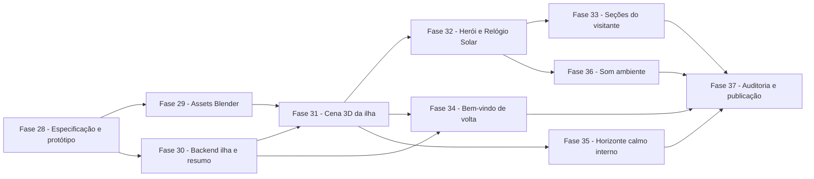

# Roteiro de desenvolvimento - nova Página Inicial e Ilha-Diorama (Lume, Ciclo 6)

**Registro de situação em 27/11/2026:** documento criado após a análise detalhada da página inicial (`/`) feita com Athos. Diagnóstico: a Landing da Fase 15 funciona como **vitrine técnica** (painel do simulador, cartão de saúde da API, cartão de prioridades, textos sobre WebGL e Hemisfério Sul) e não como **tela de boas-vindas**; usuários novos e antigos veem a mesma página; o cenário 3D procedural (colinas senoidais, arbustos em icosaedros da cor da colina, flores esféricas soltas, sol sem *bloom*, sem névoa e sem pós-processamento) ficou muito abaixo da arte conceitual aprovada ([diorama-jardim-dia-3d.png](Identidade-visual/assets-3d/diorama-jardim-dia-3d.png) e [diorama-jardim-noite-3d.png](Identidade-visual/assets-3d/diorama-jardim-noite-3d.png)). Este **Ciclo 6** (Fases `28` a `37`) **substitui e absorve a Fase 24B** de [Roteiro-primeira-entrega.md](Roteiro-primeira-entrega.md) (`ID-40`, `ID-41`), conforme `ID-43` a `ID-48` em [Registro-de-ideias-e-decisoes.md](Registro-de-ideias-e-decisoes.md). **Nenhuma fase iniciada.** Próxima etapa: **Fase 28 - especificação, direção de arte e protótipo da nova página inicial**. Pendência mais urgente: aprovação dos entregáveis da Fase 28 (`D19` textos, `D20` e `D21`). `D17` fechada em `ID-49` (ciclo completo, sem corte).

**Escopo do Ciclo 6:** reconstruir a página inicial do Lume como uma experiência de boas-vindas memorável e "fora da curva", com uma **ilha-diorama flutuante em estilo massinha** (fiel à arte conceitual) como protagonista, modelada em `.glb` por **scripts Python no Blender 4.2** e renderizada com material *clay* e pós-processamento; **layout híbrido** (herói em tela cheia + seção "o dia passa" guiada pela rolagem + seções 2D com os cartões atuais); **Relógio Solar arrastável** como interação assinatura; versão **"bem-vindo de volta"** para usuários autenticados com a **ilha pessoal que evolui com o progresso real**; **horizonte calmo e desfocado** nas telas internas; **som ambiente opt-in**; tudo mantendo custo zero, `pt-BR`, SOLID, TDD, WCAG AA, `prefers-reduced-motion` e Fallback 2D.

---

## 1. Como executar o roteiro

Valem integralmente as regras de [Regras.md](../Agents/Regras.md) e a seção 1 de [Roteiro-primeira-entrega.md](Roteiro-primeira-entrega.md) (responsabilidades, estados permitidos por fase, critério de `[x]` e autorização de `git commit`/`git push` ao concluir cada fase no padrão `Fase NN: objetivo da fase`).

### Particularidades deste ciclo
- **Arte também é especificação:** a arte conceitual aprovada (`D04`) é a referência visual oficial da ilha. Cada etapa visual relevante passa por **aprovação de Athos com capturas reais** (desktop e celular, nos 4 momentos do dia) antes de ser considerada concluída.
- **TDD onde há comportamento:** regras da ilha (estágios, vitalidade, murchar), resumo do usuário, perfis de desempenho, mapeamentos de momento do dia para iluminação, Relógio Solar (valor, teclado, ARIA), abertura cinematográfica (primeira visita, pular, movimento reduzido), roteamento novo/antigo usuário e validação automática do orçamento dos `.glb` seguem **Vermelho → Verde → Refatoração**. O acabamento artístico puro é validado por inspeção visual registrada.
- **Assets reproduzíveis:** todo `.glb` é gerado por script versionado (Blender em modo `--background --python`), nunca editado manualmente sem script correspondente, garantindo que qualquer ajuste seja repetível.
- **Orçamento antes de beleza:** nenhuma fase visual é concluída se estourar o orçamento de desempenho definido na Fase 28.

### Controle geral de conclusão das fases

- [ ] Fase 28 - especificação, direção de arte, storyboard, orçamento de desempenho e protótipo da nova página inicial
- [ ] Fase 29 - pipeline de assets 3D no Blender por script e ilha-diorama modular em `.glb` otimizado (TDD de orçamento)
- [ ] Fase 30 - backend do estado da ilha e do resumo de boas-vindas (`GET /api/inicio`) (TDD)
- [ ] Fase 31 - nova cena 3D da ilha: material *clay*, pós-processamento, astros, clima, perfis, pôster e abertura cinematográfica (TDD)
- [ ] Fase 32 - página do visitante (parte 1): herói sem cartão, CTA único, Relógio Solar arrastável e limpeza da Landing antiga (TDD)
- [ ] Fase 33 - página do visitante (parte 2): seção "o dia passa", Como funciona, demo árvore ↔ ilha, Feito com cuidado e rodapé (TDD)
- [ ] Fase 34 - página "bem-vindo de volta" do usuário autenticado com ilha pessoal, resumo e tarefa rápida (TDD)
- [ ] Fase 35 - horizonte calmo e desfocado nas telas internas e separação do chunk 3D pesado (TDD)
- [ ] Fase 36 - som ambiente opt-in da página inicial (pássaros, grilos, vento) (TDD)
- [ ] Fase 37 - auditoria de desempenho e acessibilidade, publicação e aceitação do Ciclo 6

### Trilha mínima para a apresentação (descartada em `D17`)

Proposta original para prazo curto: priorizar **28 → 29 → 30 → 31 → 32 → 34 → 37**, deixando **33, 35 e 36** para depois. Como Athos confirmou haver tempo suficiente (`ID-49`), o ciclo será executado **completo e na ordem numérica**.

---

## 2. Distribuição do Ciclo 6

| Ciclo | Fases | Objetivo principal | Foco metodológico |
| --- | --- | --- | --- |
| Ciclo 6 | 28-37 | Nova página inicial de boas-vindas com ilha-diorama 3D evolutiva, Relógio Solar, versão "bem-vindo de volta", horizonte calmo interno e som ambiente (substitui a Fase 24B) | SDD visual com aprovação por capturas, pipeline 3D reproduzível, TDD de regras e orçamento, WCAG AA e desempenho medido |

---

## 3. Decisões do ciclo

### 3.1 Decisões já fechadas com Athos em 27/11/2026

| Tema | Decisão | Registro |
| --- | --- | --- |
| Substituição da Fase 24B | O Ciclo 6 substitui e absorve a Fase 24B em documento próprio | `ID-43` |
| Direção de layout | **Híbrida:** herói com diorama 3D em tela cheia + uma seção "o dia passa" guiada pela rolagem + seções 2D | `ID-47` |
| Direção artística | **Fiel à arte conceitual:** ilha-diorama flutuante em massinha (ponte, lago, caminho de pedras, lanternas, árvores fofas, flores, vagalumes, constelações) | `ID-44` |
| Produção 3D | Modelos `.glb` gerados por **scripts Python no Blender 4.2** (`C:\Program Files\Blender Foundation\Blender 4.2\blender.exe`), material *clay* e pós-processamento; revisa a parte "zero `.glb`" de `D13` | `ID-44` |
| Usuário autenticado em `/` | Versão **"bem-vindo de volta"**: saudação com nome e avatar, a ilha pessoal, resumo e atalhos | `ID-46` |
| Ilha evolutiva | A ilha reflete o progresso real (regra detalhada abaixo) | `ID-45` |
| Simulador da Landing | Substituído pelo **Relógio Solar arrastável** com ícones de clima discretos | `ID-47` |
| Cartões técnicos | "Conexão com o backend" vira um **pontinho de status no rodapé**; "Prioridades acessíveis" é removido e as prioridades aparecem **dentro da demo** | `ID-47` |
| Seções do visitante | Herói com único botão, Como funciona (3 passos), Demo árvore ↔ ilha, Feito com cuidado, Chamada final + rodapé. **Sem** galeria de telas e **sem** seção técnica | `ID-47` |
| Tom de voz | Poético e acolhedor, mas claro (base: *"Suas tarefas no ritmo vivo do dia"*) | `ID-47` |
| Cartões | **Estilo atual preservado exatamente**, apenas reorganizado; **somente o herói fica sem cartão** (texto direto sobre o cenário com contraste garantido) | `ID-47` |
| Escopo do cenário | Ilha completa e viva **só na página inicial**; telas internas recebem **horizonte calmo e desfocado** | `ID-48` |
| Abertura | Introdução cinematográfica de cerca de `2s` (câmera se aproxima da ilha e o título se escreve), **só na primeira visita**, com botão **Pular** e desativada com movimento reduzido | `ID-48` |
| Mascote | **Não** haverá mascote | `ID-48` |
| Celular | 3D leve (menos detalhes, pós-processamento reduzido); aparelhos fracos ou sem WebGL usam a **imagem-pôster animada** | `ID-48` |
| Resumo do usuário que volta | Tarefas de hoje (quantas e quais), progresso da semana, sequência de dias ativos, atalho **Adicionar tarefa rápida** e frase do momento do dia | `ID-46` |
| Som | Som ambiente **opt-in** (pássaros, grilos, vento), sempre desligado até o clique | `ID-48` |

### 3.2 Regra de evolução da ilha (`ID-45`)

A ilha combina três camadas independentes, todas calculadas no backend por função de domínio pura:

| Camada | Fonte | Comportamento | Regressão |
| --- | --- | --- | --- |
| **Estrutura permanente** | Total acumulado de tarefas concluídas pelo usuário | Desbloqueia elementos por estágio (ex.: broto → jardim → bosque → lago e ponte → ilha completa com lanternas e constelações próprias) | **Nunca regride** |
| **Vitalidade da semana** | Progresso da semana corrente | Controla a quantidade de flores abertas, saturação das cores e brilho dos vagalumes | Reinicia toda **segunda-feira** (fuso do usuário, mesma regra de Estatísticas) |
| **Murchar suave** | Dias consecutivos sem concluir nenhuma tarefa | A partir de **3 dias** sem conclusão, as flores perdem cor e inclinam gradualmente; ao concluir qualquer tarefa, voltam ao normal | Afeta só flores e cores, **nunca a estrutura** |

- **Visitante:** vê uma ilha de vitrine (estágio máximo, vitalidade cheia) cujas flores respondem à demo da árvore local.
- **Conta recém-criada:** começa no estágio inicial (broto), criando a narrativa "o seu jardim começa agora".
- Limiares numéricos dos estágios, fórmula da vitalidade e curva do murchar ficam para aprovação em `D20`.

### 3.3 Decisões pendentes (`D17`-`D22`)

| ID | Decisão | Preparação esperada da IA | Responsável | Fase limite | Situação |
| --- | --- | --- | --- | --- | --- |
| D17 | **Data da apresentação Web II** e corte de escopo do Ciclo 6 | Propor trilha mínima (seção 1) e estimativa por fase conforme a data | Athos informa a data; IA propõe o corte | Antes da Fase 29 | Aprovada em 27/11/2026 (`ID-49`): Athos confirmou que **há tempo suficiente para o ciclo completo**; executar as Fases `28` a `37` na ordem do roteiro, **sem corte de escopo** |
| D18 | Aprovação do **blockout da ilha** (formas, composição, proporção e silhueta) antes do refinamento | Gerar blockout por script e renderizar capturas dia/noite pelo Blender e no navegador | IA produz; Athos aprova | Fase 29 | Pendente |
| D19 | **Textos finais** da página (H1, subtítulo, 3 passos, Feito com cuidado, chamada final) e catálogo de **frases do momento do dia** | Entregar 2-3 opções por bloco no tom aprovado, com bold/itálico do Guia visual | IA propõe; Athos escolhe | Fase 28 (textos) e Fase 34 (frases) | Pendente |
| D20 | **Limiares dos estágios**, fórmula da vitalidade semanal e curva do murchar | Simular cenários reais (usuário leve, médio e intenso) e mostrar a ilha resultante | IA propõe; Athos aprova | Fase 30 | Pendente. Proposta inicial: estágios em `0`, `5`, `20`, `50` e `100` concluídas; vitalidade = concluídas na semana ÷ meta semanal (padrão `7`, limitada a `1`); murchar de `25%` no 3º dia até `70%` no 7º dia |
| D21 | **Orçamento de desempenho** final (tamanho dos `.glb`, triângulos, FPS mínimo, LCP) | Medir em notebook comum e celular intermediário e propor números | IA mede e propõe; Athos aprova | Fase 28 | Pendente. Proposta inicial na Fase 28 |
| D22 | Adotar **Playwright** para capturas automáticas de regressão visual da página inicial | Comparar custo (dependência de desenvolvimento, gratuita) e benefício para validar 4 momentos x 5 climas | IA analisa; Athos decide | Fase 31 | Pendente |

---

## 4. Ciclo 6 - Nova Página Inicial e Ilha-Diorama (Fases 28-37)

### Fase 28 - Especificação, direção de arte, storyboard, orçamento de desempenho e protótipo da nova página inicial

**Depende de:** análise de 27/11/2026, decisões `ID-43` a `ID-48`; não depende de código.

- Atualizar os documentos SDD afetados:
  - [Detalhes.md](Detalhes.md): fluxos da página inicial do visitante e do usuário autenticado, regras da ilha evolutiva (`ID-45`), Relógio Solar, abertura cinematográfica, rodapé com status e som ambiente.
  - [Guia-visual.md](Guia-visual.md): nova seção **Página inicial e Ilha-Diorama** (composição do herói, escala tipográfica do H1, proteção de contraste do texto sobre o cenário em todos os `1.440` minutos, ritmo das seções, uso dos cartões atuais, paleta das lanternas e vagalumes, linguagem visual dos estágios da ilha e do murchar).
  - [Planejamento-tecnico.md](Planejamento-tecnico.md): pipeline Blender por script, formato `.glb` com compressão (Draco ou Meshopt), `@react-three/postprocessing`, uso do `drei` já instalado (`Float`, `useGLTF`, `ContactShadows`, `Sparkles`), `motion` (`useScroll`) para a rolagem, estratégia de imagem-pôster e separação de chunks; registrar a revisão parcial de `D13`.
  - [Contratos-api.md](Contratos-api.md): contrato de `GET /api/inicio` (seção da Fase 30).
- Produzir o **storyboard** da seção "o dia passa" (4 quadros: alvorada, tarde, crepúsculo, noite) indicando posição da câmera, iluminação e a mensagem de cada quadro.
- Produzir protótipo estático navegável em `Doc/Prototipos/pagina-inicial/` (visitante e "bem-vindo de volta", desktop e celular), usando a arte conceitual como placeholder do 3D.
- Propor o **orçamento de desempenho** (`D21`): tamanho máximo dos `.glb` comprimidos, teto de triângulos por perfil, FPS mínimo, LCP com pôster, tamanho máximo dos chunks da página inicial.
- Entregar as opções de texto (`D19`, parte de textos) e a proposta numérica de `D20`.

**Entrega:** especificação completa da nova página inicial, storyboard, protótipo navegável e orçamento de desempenho.

**Concluída quando:** Athos aprova protótipo, storyboard, textos e orçamento (`D19` textos, `D21`), e os documentos SDD estão atualizados e coerentes entre si.

---

### Fase 29 - Pipeline de assets 3D no Blender por script e ilha-diorama modular em `.glb` otimizado (TDD de orçamento)

**Depende de:** Fase 28; decisões `D18` e `D21`.

- Criar a pasta versionada `Frontend/ferramentas/blender/` com scripts Python executáveis em modo não interativo (`blender.exe --background --python <script>.py`), documentando o comando em [Ambiente-local.md](Ambiente-local.md).
- **Blockout primeiro:** gerar por script a silhueta da ilha (disco de terra flutuante com base rochosa, lago em dois lóbulos, ponte em arco, caminho de pedras, posições de árvores, lanternas e canteiros), renderizar capturas dia/noite e submeter a `D18`.
- **Refinamento modular** após `D18`, separando os elementos por estágio da ilha para que o frontend ligue e desligue cada grupo:
  - Base da ilha, grama e rochas (sempre visíveis).
  - Árvores "fofas" em massinha, arbustos e canteiros de flores (com vértices preparados para animação de vento e variação de cor por vitalidade).
  - Lago com superfície separada (material de água no frontend), ponte e caminho.
  - Lanternas com malha emissiva separada (acendem no crepúsculo).
- Nomear objetos, materiais e grupos em `pt-BR` (`ilha_base`, `arvores_estagio_3`, `lanternas_emissivas`), exportar `.glb` e otimizar (deduplicação, *weld*, compressão Draco ou Meshopt) com ferramentas gratuitas (`gltf-transform`).
- Gerar a **imagem-pôster** (WebP/AVIF, dia e noite) a partir da própria cena para uso como LCP e Fallback 2D.
- Escrever teste automatizado (Vitest em Node, lendo os `.glb` com `@gltf-transform/core`) que **falha se o orçamento for violado** (tamanho em kB, triângulos por perfil, presença dos grupos nomeados obrigatórios).
- Registrar procedência e licença em [ORIGEM-E-LICENCAS.md](Identidade-visual/ORIGEM-E-LICENCAS.md) (autoria própria por script; se algum pacote CC0 for usado como base, registrar origem e licença).

**Entrega:** ilha-diorama modular em `.glb` otimizado, pôsteres e pipeline reproduzível por script.

**Concluída quando:** `D18` aprovado, scripts regeneram os assets do zero, o teste de orçamento passa e Athos aprova capturas renderizadas dia e noite.

---

### Fase 30 - Backend do estado da ilha e do resumo de boas-vindas (`GET /api/inicio`) (TDD)

**Depende de:** Fase 28; decisão `D20`.

- Implementar domínio puro (sem FastAPI, SQLAlchemy ou PyMongo) em `Backend/src/dominio/ilha_jardim.py`:
  - `calcular_estagio_estrutural(total_concluidas)` com limiares de `D20`, monotônico e sem regressão.
  - `calcular_vitalidade_semanal(concluidas_na_semana, meta_semanal)` com início da semana na segunda-feira no fuso do usuário.
  - `calcular_nivel_murcha(dias_sem_conclusao)` com início no 3º dia e recuperação imediata após nova conclusão.
- Implementar serviço `servico_inicio.py` com contratos (`Protocol`) segregados para leitura de contagens (PostgreSQL como fonte de verdade) e reaproveitamento da sequência de dias já calculada por Estatísticas, sem duplicar regra.
- Expor `GET /api/inicio` autenticado (sessão + posse por `usuario_id`), com resposta em `snake_case`, incluindo:
  - `nome_exibicao`, `avatar` (mesmo formato já usado na sessão).
  - `tarefas_hoje` (contagem e lista resumida limitada, com `id`, `titulo`, `prioridade`, `turno`, `prazo`).
  - `progresso_semana`, `sequencia_atual_dias`.
  - `ilha` com `estagio`, `vitalidade`, `nivel_murcha`, `dias_sem_conclusao`, `total_concluidas`.
- Erros no contrato único (`NAO_AUTORIZADO` etc.), `Cache-Control: no-store`, documentação em [Contratos-api.md](Contratos-api.md) e regeneração de [openapi.json](openapi.json).
- Testes: unitários do domínio (limiares, fronteira de semana, murchar e recuperação, nunca regredir) e integração contra bancos `_teste` (isolamento entre usuários, conta nova no estágio inicial, usuário sem tarefas).

**Entrega:** endpoint de resumo de boas-vindas com estado da ilha calculado no servidor.

**Concluída quando:** `ruff`, `mypy` e `pytest` passam com os novos cenários e o contrato está documentado.

---

### Fase 31 - Nova cena 3D da ilha: material *clay*, pós-processamento, astros, clima, perfis, pôster e abertura cinematográfica (TDD)

**Depende de:** Fases 29 e 30; decisão `D22`.

- Criar `Frontend/src/cenario/ilha3d/` com a nova cena, mantendo a fronteira atual (`CenarioDoHorizonte` decide entre 3D e Fallback 2D, com `ErrorBoundary` e perda de contexto WebGL):
  - Carregamento dos `.glb` com `useGLTF` (pré-carregamento e Draco/Meshopt), grupos ligados ou desligados pelo estágio da ilha.
  - Material *clay* (toon ou shader próprio com *rim light*) fiel à arte conceitual; água com reflexo suave; grama e flores com vento em shader; ilha flutuando com `Float`; sombra de contato.
  - Astros: sol com *bloom* real, Lua 3D mantendo a fase real do Hemisfério Sul (lógica existente reaproveitada), estrelas e constelações; lanternas acendendo no crepúsculo; vagalumes à noite (`Sparkles` ou instâncias).
  - Clima reativo (5 estados) adaptado à composição da ilha: nuvens ao redor, chuva e relâmpagos.
  - Pós-processamento com `@react-three/postprocessing` (Bloom, Vinheta, SMAA, *tone mapping*), desligado ou reduzido no perfil celular.
- Lógica pura e testada em `logica-ilha-3d.ts`: mapa estágio → grupos visíveis; vitalidade → quantidade de flores, saturação e brilho; nível de murcha → dessaturação e inclinação; momento do dia → iluminação, emissivo das lanternas e intensidade do *bloom*; perfil de desempenho por largura e capacidade.
- **Imagem-pôster** exibida imediatamente (LCP) com transição suave para o 3D quando estiver pronto; pôster animado (leve paralaxe CSS) como fallback de aparelhos fracos.
- **Abertura cinematográfica** de cerca de `2s` só na primeira visita (marcação em `localStorage`), com botão **Pular**, foco gerenciado e desativada com `prefers-reduced-motion`.
- Limpeza rigorosa de recursos (geometrias, materiais, texturas, *composer* de pós-processamento) ao desmontar e pausa com aba oculta.
- Se `D22` aprovado, capturas automáticas dos 4 momentos x 5 climas como referência visual.

**Entrega:** ilha-diorama 3D viva, evolutiva e reativa ao dia e ao clima, com pôster e abertura.

**Concluída quando:** testes de lógica e de alternância 3D/2D passam, o orçamento de `D21` é respeitado e Athos aprova capturas reais nos 4 momentos e 5 climas em desktop e celular.

---

### Fase 32 - Página do visitante (parte 1): herói sem cartão, CTA único, Relógio Solar arrastável e limpeza da Landing antiga (TDD)

**Depende de:** Fase 31; decisão `D19` (textos).

- Reestruturar `Frontend/src/dominios/landing/` separando responsabilidades (página do visitante, herói, Relógio Solar, rodapé) segundo SRP.
- **Herói em tela cheia sem cartão:** marca, H1 curto com bold/itálico expressivo, subtítulo de uma linha e **um único** botão "Começar com Google"; texto posicionado para não cobrir a ilha e protegido por véu/gradiente cromático que garante contraste WCAG AA nos `1.440` minutos (teste automatizado sobre o sistema cromático).
- **Relógio Solar arrastável:** arco no horizonte (ou mostrador circular, conforme protótipo aprovado) em que o visitante arrasta o sol e a página inteira muda de cor; botão para voltar ao horário real; 5 ícones de clima discretos.
  - Acessibilidade: `role="slider"`, `aria-valuetext` em português ("14:30, Tarde"), setas e `Home`/`End` no teclado, alvo de toque confortável, foco visível.
- Remover da página inicial o painel `BarraArcoDoDia` (permanece onde já é usado nas telas internas), o cartão "Prioridades acessíveis", o modal "Sobre o sistema visual" e o `CartaoStatusApi`; o status vira **pontinho no rodapé** com texto acessível ("Serviços operando normalmente").
- Atualizar os testes de integração existentes que dependiam da Landing antiga, preservando os fluxos de autenticação.

**Entrega:** primeira dobra da nova página inicial com herói, Relógio Solar e rodapé com status.

**Concluída quando:** testes (Relógio Solar por teclado e ponteiro, contraste do herói, CTA único, ausência dos cartões técnicos) passam e Athos aprova a primeira dobra ao vivo.

---

### Fase 33 - Página do visitante (parte 2): seção "o dia passa", Como funciona, demo árvore ↔ ilha, Feito com cuidado e rodapé (TDD)

**Depende de:** Fase 32.

- **Seção "o dia passa"** guiada pela rolagem (`motion` `useScroll`): a câmera percorre a ilha da alvorada à noite conforme o storyboard da Fase 28, com uma mensagem curta por momento. Com movimento reduzido, vira 4 painéis estáticos sem animação de câmera.
- **Como funciona em 3 passos:** *Organize em ramos* → *Cultive seu jardim* → *Acenda constelações*, nos cartões atuais, com microanimação discreta.
- **Demo árvore ↔ ilha:** a árvore local existente (`DemoArvoreInterativa`) em destaque; marcar uma subtarefa faz uma flor nascer ao vivo na ilha; as 4 prioridades aparecem nos próprios itens da demo (substituindo o cartão removido).
- **Feito com cuidado:** acessibilidade, PWA instalável e privacidade (login Google sem senha, exclusão total de conta) em linguagem humana.
- **Chamada final + rodapé:** repetição única do CTA, créditos, disciplina Web II, link do GitHub, licenças e pontinho de status.

**Entrega:** página do visitante completa, do herói ao rodapé.

**Concluída quando:** testes (demo ligada à ilha, fallback estático da seção de rolagem, navegação por teclado, ausência de rolagem horizontal de `320px` a telas amplas) passam e Athos aprova a página completa ao vivo.

---

### Fase 34 - Página "bem-vindo de volta" do usuário autenticado com ilha pessoal, resumo e tarefa rápida (TDD)

**Depende de:** Fases 30 e 31; decisão `D19` (frases).

- Roteamento em `/`: visitante → página do visitante; autenticado com primeiro acesso pendente → `/primeiro-acesso`; autenticado → **bem-vindo de volta** (lógica pura testada).
- Saudação *"Boa tarde, **Athos**"* com avatar, sobre a **ilha pessoal** (estado vindo de `GET /api/inicio`).
- Resumo nos cartões atuais: **tarefas de hoje** (quantas e quais, com link para cada uma na Jornada), **progresso da semana**, **sequência de dias ativos**.
- **Adicionar tarefa rápida:** campo único que cria tarefa raiz pela API existente (CSRF, validação Zod alinhada aos limites de `D09`), atualizando resumo e ilha.
- **Frase do momento do dia:** catálogo local em `pt-BR` por momento (`D19`), escolhida de forma determinística por dia.
- Botão **Continuar na Jornada**; mensagens gentis quando a ilha está murchando (sem tom punitivo).
- Estados de carregamento (esqueleto), erro (código estável) e conta nova (estágio broto com convite para a primeira tarefa).

**Entrega:** página de boas-vindas personalizada para quem já tem conta.

**Concluída quando:** testes (roteamento, mapeamento do resumo, tarefa rápida com CSRF, estados vazio/erro/carregamento) passam e Athos aprova ao vivo com a própria conta.

---

### Fase 35 - Horizonte calmo e desfocado nas telas internas e separação do chunk 3D pesado (TDD)

**Depende de:** Fase 31.

- Substituir o cenário procedural antigo nas rotas internas (Jornada, Mapa, Foco, Calendário, Estatísticas, Perfil) por um **horizonte calmo**: céu cromático 24h, silhueta distante e desfocada da ilha (ou pôster desfocado), astros e clima suavizados, sem competir com os painéis.
- Carregar o chunk pesado da ilha **somente em `/`**, reduzindo o peso das telas internas (hoje o chunk `Cenario3D` tem cerca de `930 kB`).
- Preservar o véu contemplativo do Modo Foco e o progresso refletido no horizonte.
- Remover o código 3D procedural que ficar sem uso, mantendo os testes de alternância 3D/2D e de pausa em aba oculta.

**Entrega:** telas internas com fundo harmonioso e mais leve, absorvendo o objetivo de enquadramento da antiga Fase 24B.

**Concluída quando:** testes passam, o tamanho dos chunks das rotas internas cai de forma medida e Athos aprova as telas internas ao vivo.

---

### Fase 36 - Som ambiente opt-in da página inicial (pássaros, grilos, vento) (TDD)

**Depende de:** Fase 32.

- Estender o controlador de áudio existente (Web Audio API procedural, `D15`, `0 KB` extras) com paisagens da ilha: pássaros de manhã e tarde, grilos à noite e vento suave, reagindo ao momento do dia, ao Relógio Solar e ao clima.
- Botão discreto de som na página inicial, **sempre desligado até o clique**; visitante guarda a escolha em `localStorage`; usuário autenticado usa `preferencias_cenario` existente.
- Atualizar [Licencas-audio.md](Licencas-audio.md) se houver qualquer novo recurso sonoro.

**Entrega:** atmosfera sonora opcional da ilha.

**Concluída quando:** testes (opt-in, persistência, troca por momento e clima, limpeza ao desmontar) passam e Athos aprova a escuta.

---

### Fase 37 - Auditoria de desempenho e acessibilidade, publicação e aceitação do Ciclo 6

**Depende de:** Fases 28 a 36 (ou da trilha mínima aprovada em `D17`).

- Medir e registrar: LCP, CLS, tamanho de chunks, FPS em notebook comum e celular intermediário, consumo com aba oculta, comparando com o orçamento de `D21`.
- Auditar acessibilidade: contraste do herói e dos cartões nos `1.440` minutos, teclado completo (Relógio Solar, abertura, seções), leitores de tela, `prefers-reduced-motion`, Modo Desempenho e Fallback 2D.
- Executar a verificação completa (`ruff`, `mypy`, `pytest`, `prettier`, `eslint`, `tsc`, `vitest`, `vite build`), publicar na Vercel/Render e validar ao vivo os 4 momentos e 5 climas em produção.
- Atualizar [README.md](../README.md), [Roteiro-apresentacao-Web-II.md](Roteiro-apresentacao-Web-II.md) (abrir a apresentação pela nova página inicial) e o registro de situação deste documento.

**Entrega:** nova página inicial publicada, medida e aceita.

**Concluída quando:** todas as verificações passam, o orçamento é respeitado, a produção é validada ao vivo e Athos aceita formalmente o Ciclo 6.
